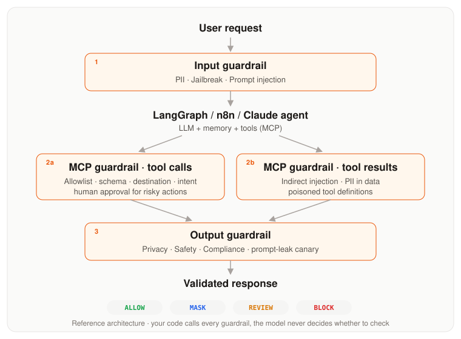

<div align="center">

# Awesome AI Agent Safety [](https://awesome.re)

**A curated, hands-on guide to securing AI agents: prompt injection, MCP and tool security, privacy, guardrails, red teaming and governance.**

300+ curated links to tools, papers, benchmarks, standards and incidents, plus **runnable labs** where you attack an agent and then defend it.

[](https://github.com/ProofAgent-ai/awesome-ai-agent-safety/actions/workflows/tests.yml)
[](https://github.com/ProofAgent-ai/awesome-ai-agent-safety/actions/workflows/links.yml)
[](LICENSE)
[](CONTRIBUTING.md)

</div>

---

An agent reads text from strangers (users, web pages, emails, documents, tool output) **and it can act**: send email, run code, move money, call MCP servers. Simon Willison calls the combination of **private data + untrusted content + a way to send data out** [the lethal trifecta](https://simonwillison.net/2025/Jun/16/the-lethal-trifecta/). Most production agents have all three.

This repo collects what you need to build agents that survive contact with attackers, and lets you **try every idea in under a minute, offline, with no API key**.

```bash
git clone https://github.com/ProofAgent-ai/awesome-ai-agent-safety && cd awesome-ai-agent-safety
python3 labs/04-fully-guarded-agent/run.py     # watch attacks succeed, then fail
python3 run_tests.py                           # 35 tests, Python 3.10+, no dependencies
```

## Contents

- [The reference architecture: a fully guarded agent](#the-reference-architecture-a-fully-guarded-agent)
- [Hands-on labs](#hands-on-labs)
- [1. AI agent security 101](#1-ai-agent-security-101)
- [2. Prompt injection and jailbreaks](#2-prompt-injection-and-jailbreaks)
- [3. MCP and tool security](#3-mcp-and-tool-security)
- [4. Privacy and data protection](#4-privacy-and-data-protection)
- [5. Guardrails](#5-guardrails)
- [6. Evaluation and red teaming](#6-evaluation-and-red-teaming)
- [7. Governance](#7-governance)
- [8. Standards and frameworks](#8-standards-and-frameworks)
- [9. Research papers](#9-research-papers)
- [10. Benchmarks and datasets](#10-benchmarks-and-datasets)
- [11. Incidents](#11-incidents)
- [12. Learning resources](#12-learning-resources)
- [Framework examples](#framework-examples)
- [Contributing](#contributing)

## The reference architecture: a fully guarded agent

<p align="center"></p>

| # | Checkpoint | What arrives | Main threats | OWASP |
|---|---|---|---|---|
| **1** | Input | The user's message | Direct injection, jailbreaks, PII | LLM01, LLM02 |
| **2a** | Tool call | What the agent wants to *do* | Excessive agency, data sent out, tool misuse | LLM06, ASI02 |
| **2b** | Tool result | Pages, files, emails, API and MCP responses | **Indirect injection**, poisoned tools | LLM01, ASI04 |
| **3** | Output | The reply | PII leaks, system-prompt leaks, unsafe content | LLM02, LLM07 |

Three rules make it work, and [Lab 04](labs/04-fully-guarded-agent) shows each one in code:

1. **Your code calls the guard, not the model.** If the LLM decides whether to check, an injection can talk it out of checking.
2. **Rules first, models second.** Allowlists, schemas and pinned tools are instant and can't be argued with. A guard model judges what the rules let through.
3. **Every decision has four outcomes:** allow, mask, **human review** and block. Fail closed when the guard is unavailable.

Deep dive: [docs/agent-threat-models.md](docs/agent-threat-models.md).

## Hands-on labs

Each lab has an **unprotected baseline**, a **guarded** version, **tests** and the **expected outcome**. Every lab works with the built-in offline guard; pass `--guard proofagent`, or [add your own backend](CONTRIBUTING.md#add-a-guard-backend).

| Lab | You learn to | Baseline → guarded |
|---|---|---|
| [01 · Prompt injection](labs/01-prompt-injection) | Detect instructions in user and retrieved content, and **measure** a detector honestly | 0% → 100% detection on the core set; 0/4 on known evasions (on purpose) |
| [02 · MCP tool poisoning](labs/02-mcp-tool-poisoning) | Scan and pin tool definitions, stop rug pulls, validate arguments, clean results | 3 poisoned tools loaded → 1 clean tool loaded |
| [03 · Privacy protection](labs/03-privacy-protection) | Mask PII and secrets locally on CPU, keep the vault, restore on your side | 7/7 values reach the model → 0/7 |
| [04 · Fully guarded agent](labs/04-fully-guarded-agent) | Wire all four checkpoints with allow / mask / review / block | 5/5 attacks succeed → 0/5, benign tasks still work |
| [05 · Agent red teaming](labs/05-agent-red-teaming) | Run multi-turn attacks and produce an attack-success rate and findings | 100% → 0% attack success rate, with the stopping checkpoint per scenario |
| [06 · MCP guard server](labs/06-mcp-guard-server) | Call a guardrail over MCP at every checkpoint, risk-score side-effect actions and hold them for human approval | 6/6 attacks succeed → 0/6, large payment waits for approval |

> The built-in `local` guard is a set of transparent regex rules for **learning**. It is easy to evade (Lab 01 shows how). Production systems need a model-based guard **and** the deterministic controls from Labs 02 and 04.

## 1. AI agent security 101

- [The lethal trifecta for AI agents](https://simonwillison.net/2025/Jun/16/the-lethal-trifecta/) - Simon Willison. The simplest useful threat model for agents.
- [OWASP Top 10 for LLM Applications 2025](https://genai.owasp.org/llm-top-10/) and the [OWASP Top 10 for Agentic Applications](https://genai.owasp.org/) - Shared vocabulary (LLM01–LLM10, ASI01–ASI10).
- [Design Patterns for Securing LLM Agents against Prompt Injections](https://arxiv.org/abs/2506.08837) - Beurer-Kellner et al., 2025. Six patterns that trade capability for provable safety.
- [MITRE ATLAS](https://atlas.mitre.org/) - Adversary tactics and techniques against AI systems, now with agent-specific techniques.
- [Our threat-model guide](docs/agent-threat-models.md) - Attack surfaces, trust boundaries and the four checkpoints, mapped to OWASP and ATLAS.

## 2. Prompt injection and jailbreaks

- [Not what you've signed up for: indirect prompt injection](https://arxiv.org/abs/2302.12173) - Greshake et al., 2023. The paper that showed tool content can take over an LLM application.
- [Defeating Prompt Injections by Design (CaMeL)](https://arxiv.org/abs/2503.18813) - Debenedetti et al., 2025. Separates control flow from untrusted data.
- [Spotlighting](https://arxiv.org/abs/2403.14720), [StruQ](https://arxiv.org/abs/2402.06363), [SecAlign](https://arxiv.org/abs/2410.05451), [Instruction Hierarchy](https://arxiv.org/abs/2404.13208) - Model-level and prompt-level defences.
- [Universal and Transferable Adversarial Attacks (GCG)](https://arxiv.org/abs/2307.15043) · [PAIR](https://arxiv.org/abs/2310.08419) · [Crescendo](https://arxiv.org/abs/2404.01833) - How automated and multi-turn jailbreaks work.
- [Embrace The Red](https://embracethered.com/blog/) - Johann Rehberger's long-running series of real prompt-injection exploits.
- Guide: [docs/prompt-injection.md](docs/prompt-injection.md) · Lab: [01](labs/01-prompt-injection) · All papers: [resources/research-papers.md](resources/research-papers.md#prompt-injection)

## 3. MCP and tool security

- [MCP security best practices](https://modelcontextprotocol.io/specification/draft/basic/security_best_practices) - The official guidance on confused deputies, token passthrough, session hijacking and more.
- [Tool poisoning attacks](https://invariantlabs.ai/blog/mcp-security-notification-tool-poisoning-attacks) - Invariant Labs. Instructions hidden in tool descriptions.
- [Agent Scan (formerly mcp-scan)](https://github.com/snyk/agent-scan) - Scans MCP servers for tool poisoning, rug pulls and toxic flows. `OSS`
- [Cisco MCP Scanner](https://github.com/cisco-ai-defense/mcp-scanner) - YARA rules plus LLM judging for MCP servers. `OSS`
- [ProofAgent Nano MCP server](https://www.proofagent.ai/docs/guardrail#mcp) - Remote MCP guardrail with one check tool per checkpoint and human approval for risky actions; free API key. `Commercial` `Free tier`
- **47 scanners, gateways, sandboxes and write-ups:** [resources/mcp-security-tools.md](resources/mcp-security-tools.md)
- Guide: [docs/mcp-security.md](docs/mcp-security.md) · Labs: [02](labs/02-mcp-tool-poisoning), [06](labs/06-mcp-guard-server) · Script: [examples/mcp/scan_tools.py](examples/mcp)

## 4. Privacy and data protection

- [Microsoft Presidio](https://github.com/data-privacy-stack/presidio) - PII detection and anonymisation. `OSS` `MIT`
- [gitleaks](https://github.com/gitleaks/gitleaks) · [TruffleHog](https://github.com/trufflesecurity/trufflehog) · [detect-secrets](https://github.com/Yelp/detect-secrets) - Secret scanners for code, logs and prompts. `OSS`
- [Extracting Training Data from Large Language Models](https://arxiv.org/abs/2012.07805) - Carlini et al., 2021. Why anything you send may come back out.
- PII datasets for evaluating detectors: [resources/datasets.md](resources/datasets.md#pii-and-privacy)
- Guide: [docs/privacy-and-pii.md](docs/privacy-and-pii.md) · Lab: [03](labs/03-privacy-protection)

## 5. Guardrails

**58 open-source and commercial guardrails**, grouped by what they do: [resources/guardrails.md](resources/guardrails.md)

| Type | Examples |
|---|---|
| Frameworks | [NeMo Guardrails](https://github.com/NVIDIA-NeMo/Guardrails) · [Guardrails AI](https://github.com/guardrails-ai/guardrails) · [LlamaFirewall](https://github.com/meta-llama/PurpleLlama/tree/main/LlamaFirewall) · [Invariant Guardrails](https://github.com/invariantlabs-ai/invariant) · [OpenAI Guardrails](https://github.com/openai/openai-guardrails-python) |
| Classifiers | Llama Guard · Prompt Guard · ShieldGemma · Granite Guardian ([details](resources/guardrails.md#detection-models-and-classifiers)) |
| PII and secrets | Presidio · gitleaks · TruffleHog · cloud DLP services ([details](resources/guardrails.md#pii-and-secrets-detection)) |
| Commercial and hosted | Cloud provider guardrails, prompt-injection APIs and agent runtime guards ([details](resources/guardrails.md#commercial-and-hosted-platforms)) |

## 6. Evaluation and red teaming

**41 red-teaming and evaluation tools:** [resources/evaluation-tools.md](resources/evaluation-tools.md)

- [PyRIT](https://github.com/microsoft/PyRIT) - Microsoft's framework for orchestrated attacks and scoring. `OSS` `MIT`
- [garak](https://github.com/NVIDIA/garak) - LLM vulnerability scanner with a large probe library. `OSS` `Apache-2.0`
- [promptfoo](https://github.com/promptfoo/promptfoo) - Red-team and regression tests that run in CI. `OSS` `MIT`
- [Inspect](https://github.com/UKGovernmentBEIS/inspect_ai) - UK AISI's evaluation framework, with agent evals. `OSS` `MIT`
- [AgentDojo](https://github.com/ethz-spylab/agentdojo) - A dynamic benchmark for prompt-injection attacks and defences on agents. `OSS`
- Lab: [05 · multi-turn red teaming](labs/05-agent-red-teaming)

## 7. Governance

- [NIST AI RMF](https://www.nist.gov/itl/ai-risk-management-framework) and its [Generative AI Profile (AI 600-1)](https://doi.org/10.6028/NIST.AI.600-1)
- [ISO/IEC 42001](https://www.iso.org/standard/42001) - AI management systems, certifiable.
- [EU AI Act](https://eur-lex.europa.eu/eli/reg/2024/1689/oj) - Obligations and dates in [resources/standards-and-frameworks.md](resources/standards-and-frameworks.md#regulation-and-codes-of-practice).
- Guide: [docs/agent-governance.md](docs/agent-governance.md) – audit trails, approval records, policy as code and evidence for auditors.

## 8. Standards and frameworks

OWASP (LLM and Agentic Top 10, AI Exchange), MITRE ATLAS, NIST, ISO/IEC 42001 and 23894, EU AI Act, Google SAIF, CoSAI, CSA AICM, the UK AI cyber security code of practice and the MCP authorization spec. Each comes with a "what it means for agent builders" note and a **threat → OWASP → ATLAS → control mapping table**: [resources/standards-and-frameworks.md](resources/standards-and-frameworks.md)

## 9. Research papers

About 90 papers in nine groups: surveys, prompt injection, defences, jailbreaks, agent and tool-use security, MCP security, privacy, multi-agent risks and evaluation methodology. See [resources/research-papers.md](resources/research-papers.md).

## 10. Benchmarks and datasets

- **31 benchmarks** (AgentDojo, InjecAgent, ASB, AgentHarm, HarmBench, JailbreakBench, WASP, MCP benchmarks…): [resources/benchmarks.md](resources/benchmarks.md)
- **25 datasets** for prompt injection, jailbreaks and PII, with licences: [resources/datasets.md](resources/datasets.md)

## 11. Incidents

Fifteen sourced real-world agent incidents and disclosures, including EchoLeak, the Slack AI exfiltration, the GitHub MCP issue, the Replit database deletion, the Amazon Q extension and the malicious postmark-mcp server. Each one comes with the attack class and the lesson: [resources/incidents.md](resources/incidents.md)

## 12. Learning resources

Essays, vendor write-ups, courses, CTFs (Gandalf, HackAPrompt, Tensor Trust…), newsletters and books: [resources/learning-resources.md](resources/learning-resources.md)

## Framework examples

| Framework | Example |
|---|---|
| LangGraph | [Guard nodes and wrapped tools](examples/langgraph) |
| Claude Code / Claude Agent SDK | [`UserPromptSubmit` / `PreToolUse` / `PostToolUse` hooks](examples/claude-code) |
| MCP clients | [Scan and pin `tools/list`](examples/mcp) |
| n8n | [Guard nodes around the AI Agent node](examples/n8n) |
| CrewAI, OpenAI Agents SDK and more | [Agent Guardrails Cookbook](https://github.com/ProofAgent-ai/agent-guardrails-cookbook) |

## Contributing

This list is meant to be neutral and useful whatever stack you run. We welcome:

- **New resources**: tools, papers, datasets or incidents, with a source link and an `OSS` / `Commercial` label.
- **Guard backends**: run the labs with NeMo, LLM Guard, Prompt Guard, a cloud guardrail or your own, and share the numbers.
- **New lab scenarios**: attacks that get past the current guards are the most valuable contribution.

Read [CONTRIBUTING.md](CONTRIBUTING.md). Every link is checked weekly in CI.

## Licence

Lists and docs: [CC0 1.0](LICENSE). Code in `guards/`, `labs/` and `examples/`: [MIT](LICENSE-CODE).

---

<sub>Maintained by [ProofAgent.ai](https://proofagent.ai), which builds open tools for AI agent evaluation, runtime safety and governance. ProofAgent's own products appear in the lists under the same rules as everyone else's. Community contributions are welcome.</sub>
